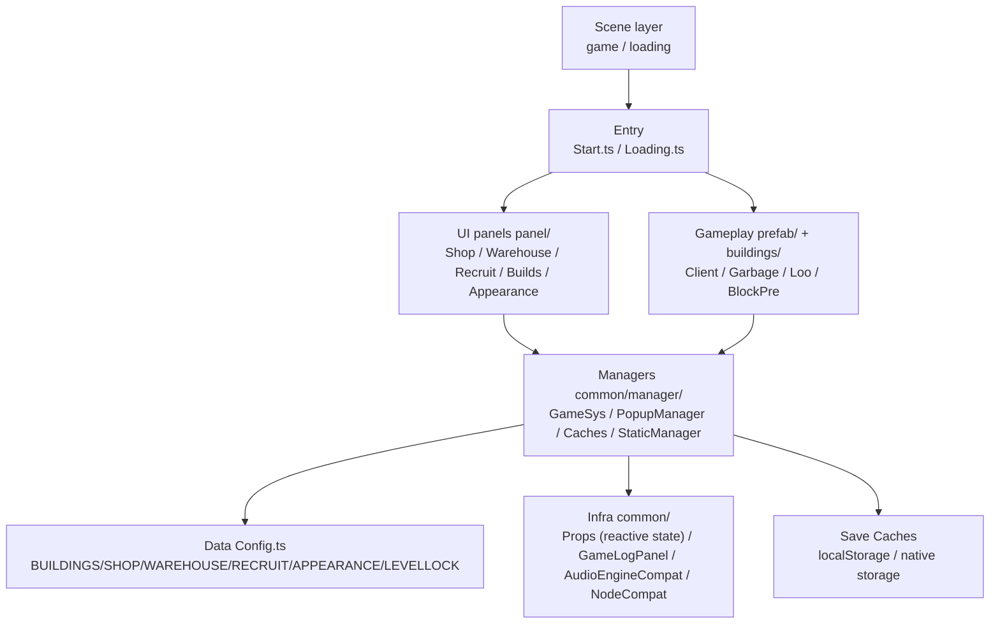

<div align="center">


# Wuxing Health Center · 五星卫生院

**A fully offline vertical idle-management mini game — take over an immortal-realm clinic and grow it into a five-star health center.**

_纯离线竖屏放置经营小游戏 · Delivered in two engine versions (Cocos Creator 2.4.12 & 3.8.8)._

[](./LICENSE)
[](./五星卫生院-3.8.8/)
[](./五星卫生院-2.4.12/)
[](./五星卫生院-3.8.8/assets/script/)
[](#-key-features)
[](#-quality--verification)

**Built end-to-end by [WorkBuddy](https://www.workbuddy.cn/) AI**: game design → UI art → code → automated testing.
Model: **HY3 (free tier)** ｜ Dev time: **6 hours**

[中文](./README.md) · [English](./README.en.md)

</div>

---

## 📖 Introduction

**Wuxing Health Center** is a vertical **idle / management** mini game. You play as the "Hygiene Master" appointed by the immortal realm, taking over a run-down clinic. Through the loop of **building facilities → restocking goods → hiring staff → cleaning**, you unlock rooms, upgrade facilities and collect decorations to turn it into a five-star health center.

The game is **100% offline**: no network requests, no ads, no login, no in-app purchases, no third-party SDKs. Saves are stored locally (Web `localStorage`, native local storage). The same game design ships in **two engine versions** — Cocos Creator **2.4.12** and **3.8.8** — serving as a real-world reference for a 2.x → 3.x engine migration.

### Key Features

- 🎮 **Complete idle-management loop**: customers generate coins → facilities get dirty → clean → upgrade → unlock new areas.
- 🏗️ **Rich progression**: 12 rooms × 3 levels, 10 cleaning items, 13 shop goods, 8 recruitable staff, 34 decorations, 39-level curve, 10 unlockable areas.
- 🧭 **32-step interactive tutorial**: hollow-out highlight + hand gesture + typewriter text.
- 📱 **All-resolution adaptation**: design resolution 750×1334, SHOW_ALL + Widget edge alignment + letterbox edge-fill — no stretch, no crop, no black bars.
- 🤖 **End-to-end automated testing**: Web traversal suite + Android adb full-widget sweep + tutorial completion + monkey stress + white-screen pixel detection.
- 🔌 **Fully offline single-player**.

### Screenshots

<table>
  <tr>
    <td align="center"><b>Announcement</b><br/></td>
    <td align="center"><b>Tutorial</b><br/></td>
    <td align="center"><b>Main scene</b><br/></td>
    <td align="center"><b>Shop</b><br/></td>
  </tr>
</table>

---

## 🚀 Quick Start

### Requirements

| Dependency | Version | Note |
|---|---|---|
| [Cocos Creator](https://www.cocos.com/creator-download) | **3.8.8** (3.x) / **2.4.12** (2.x) | Must match the target folder |
| Android NDK | **r27b (27.1.12297006)** | APK build only; ⚠️ r21e host tools crash on macOS 15+ |
| JDK | **Temurin 21** | APK build only |

### Run (Web preview)

```bash
git clone https://github.com/Pangu-Immortal/wuxing-health-center.git
cd wuxing-health-center
# Open 五星卫生院-3.8.8/ with Cocos Creator 3.8.8, then click "Preview" → Browser.
# Open 五星卫生院-2.4.12/ with Cocos Creator 2.4.12.

# Or run the prebuilt 2.x web bundle directly:
cd 五星卫生院-2.4.12/build/web-mobile
python3 -m http.server 8899   # visit http://localhost:8899/
```

### Build Android APK (3.8.8)

> ⚠️ Quit Cocos Creator before CLI build. See the [Chinese README FAQ](./README.md#-常见问题-faq) for the full command and known pitfalls (NDK version, CJK path escaping, sandbox env vars).

---

## 🎮 How to Play

1. Read the **"Immortal Assembly Announcement"** and tap **"To the Immortal Realm"**.
2. Complete the **32-step tutorial** (hollow-out highlight + gesture). The 3.8.8 build has an **8s watchdog** to auto-advance; 2.4.12 requires manual taps.
3. Run the **core loop**: customers produce coins → facilities get dirty → clean (items/staff) → upgrade rooms → unlock areas.
4. **Clear the game** by: all 12 rooms at level 3, all 10 items bought, all 13 goods stocked, all 8 staff hired, all 34 decorations unlocked, all 10 areas open, level 39.

---

## 🏗️ Architecture



The reactive core is `Props` (`xSet/xGet/xBind/xUnbind`) — a publish-subscribe "key → value + observers" model. All cross-module communication (coins, tutorial step, panel toggles) flows through it.

See the [Chinese README](./README.md#-技术架构) for the full module breakdown, data-flow sequence diagram and directory tree.

---

## ✅ Quality & Verification

The 3.8.8 build passes:

| Check | Method | Result |
|---|---|---|
| Web full traversal | agent-browser click-through | **18 PASS / 0 FAIL** |
| Tutorial completion | adb + TouchDump real-widget taps | **step 0→32 in one run** |
| Full-widget sweep | adb F11 dump → tap each → state diff | **19 PASS / 0 crash / 0 white-screen** |
| monkey stress | 600~800 random events | alive, 0 JS errors |
| Multi-resolution | 4 resolutions × 3 densities pixel scan | **0 black bars** |

---

## 📄 License & Credits

- **License**: [MIT](./LICENSE) © 2026 Hosea (Pangu-Immortal). For learning and research.
- **Engine**: [Cocos Creator](https://www.cocos.com/creator) (3.8.8 / 2.4.12).
- **Built by**: **[WorkBuddy](https://www.workbuddy.cn/)** AI end-to-end (design / UI / code / tests), model **HY3 free tier**, **6 hours**.

<div align="center">

**If this project helps you, please give it a ⭐ Star!**

_Made with 🤖 by WorkBuddy · Fully offline · MIT Licensed_

</div>
