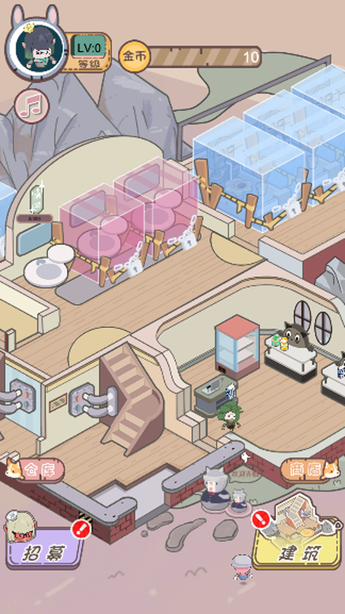
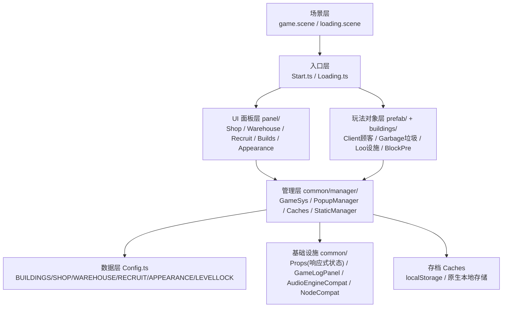
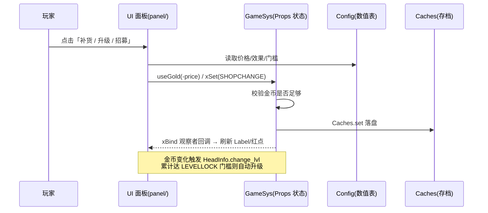

<div align="center">


# 五星卫生院 · Wuxing Health Center

**一款纯离线的竖屏放置经营小游戏 —— 接管仙界卫生院，建设、补货、招募、打扫，把它经营成五星卫生院。**

_A fully offline vertical idle-management mini game, delivered in two engine versions._

[](./LICENSE)
[](https://github.com/Pangu-Immortal/wuxing-health-center/stargazers)
[](https://github.com/Pangu-Immortal/wuxing-health-center/network)
[](https://github.com/Pangu-Immortal/wuxing-health-center/issues)
[](https://github.com/Pangu-Immortal/wuxing-health-center)
[](./五星卫生院-3.8.8/)
[](./五星卫生院-2.4.12/)
[](./五星卫生院-3.8.8/assets/script/)
[](#-快速开始)
[](#-质量与验证)
[](#-质量与验证)
[](#-核心特性)
[](#-贡献指南)

**全程由 [WorkBuddy](https://www.workbuddy.cn/) AI 独立完成**：游戏设计 → UI 图产出 → 代码实现 → 自动化测试
模型：**HY3 免费版** ｜ 研发耗时：**6 小时**

[中文](./README.md) · [English](./README.en.md) ｜ [玩法演示截图](#-运行截图) · [快速开始](#-快速开始) · [技术架构](#-技术架构)

</div>

---

<details>
<summary><b>📑 目录导航（点击展开）</b></summary>

- [项目介绍](#-项目介绍)
  - [解决的痛点](#解决的痛点)
  - [核心特性](#核心特性)
  - [适用人群与使用场景](#适用人群与使用场景)
- [运行截图](#-运行截图)
- [快速开始](#-快速开始)
  - [环境要求](#环境要求)
  - [安装与运行（Web 预览）](#安装与运行web-预览)
  - [配置项说明](#配置项说明)
  - [最小可运行示例](#最小可运行示例)
  - [打包 Android APK](#打包-android-apk)
- [使用步骤与玩法](#-使用步骤与玩法)
  - [第一步：开场与新手引导](#第一步开场与新手引导)
  - [第二步：核心经营循环](#第二步核心经营循环)
  - [进阶技巧](#进阶技巧)
  - [常见组合玩法](#常见组合玩法)
  - [成长与通关目标](#成长与通关目标)
- [技术架构](#-技术架构)
  - [分层与模块划分](#分层与模块划分)
  - [数据流向](#数据流向)
  - [关键目录结构](#关键目录结构)
  - [核心技术选型](#核心技术选型)
  - [双版本差异](#双版本差异)
- [质量与验证](#-质量与验证)
- [性能与限制](#-性能与限制)
- [同类项目对比](#-同类项目对比)
- [常见问题 FAQ](#-常见问题-faq)
- [更新日志](#-更新日志)
- [路线图](#-路线图)
- [SEO 与可发现性](#-seo-与可发现性)
- [贡献指南](#-贡献指南)
- [社区交流](#-社区交流)
- [Star 趋势](#-star-趋势)
- [许可证与致谢](#-许可证与致谢)

</details>

---

## 📖 项目介绍

《五星卫生院》是一款**竖屏放置经营（Idle / Management）小游戏**。玩家扮演被仙界任命的「卫生道长」，接手一所破旧卫生院，通过**建设设施 → 补货商品 → 招募员工 → 打扫卫生**的经营循环，逐步解锁房间、升级设施、收集外观，最终把它打造成「五星卫生院」。

游戏**100% 纯离线**：无任何网络请求、无广告、无登录、无内购、无第三方 SDK，存档保存在本地（Web 端 localStorage，原生端本地存储）。同一份游戏设计提供 **Cocos Creator 2.4.12** 与 **3.8.8** 两个引擎版本的完整源码，可作为「2.x → 3.x 引擎迁移」的真实工程范例。

### 解决的痛点

| 痛点 | 本项目的答案 |
|---|---|
| 想找一个**体量适中、可完整读懂**的 Cocos 放置经营游戏源码 | 103 个 TS 脚本、清晰分层（common/panel/prefab/buildings/labInfo），无冗余 |
| 苦于 **Cocos 2.x → 3.x 迁移**没有真实对照案例 | 同游戏双版本并存，312 处 API 适配、96→103 脚本迁移全过程可 diff |
| 需要**纯离线、可放心二次分发**的小游戏样板（无 SDK/无隐私合规负担） | 零网络、零 SDK、MIT 许可 |
| 想看**AI 端到端独立完成**一个游戏的可行性边界 | 设计/UI/代码/测试全程 AI 完成，附自动化测试与排障记录 |

### 核心特性

- 🎮 **完整放置经营循环**：顾客消费产金 → 设施脏污 → 打扫维护 → 升级扩建 → 解锁新区域，闭环自洽。
- 🏗️ **丰富的成长线**：12 个房间 × 3 级、10 种清洁道具、13 种商店商品、8 名可招募员工、34 种场景外观、39 级等级曲线、10 个逐步解锁的区域。
- 🧭 **32 步交互式新手引导**：镂空高亮 + 手势指引 + 逐字文案打字机效果，覆盖建设→升级→解锁→外观→营业→补货→打扫→仓库全流程。
- 📱 **全分辨率自适应**：设计分辨率 750×1334，SHOW_ALL + Widget 四边对齐 + letterbox 纯色延伸带，任意分辨率/像素密度/屏幕比例下无拉伸、无裁切、无黑边。
- 🤖 **端到端自动化测试基建**：浏览器全遍历套件 + Android 模拟器 adb 全控件点击遍历 + 引导走完验证 + monkey 压力测试 + 白屏像素检测。
- 🔄 **双引擎版本**：2.4.12 与 3.8.8 源码并存，天然对照。
- 🔌 **纯离线单机**：无网络、无 SDK、无广告、无内购、无登录。

### 适用人群与使用场景

- **Cocos 学习者**：读取一个结构清晰、带完整引导与经营系统的真实项目。
- **引擎迁移实践者**：对照 2.x/3.x 双版本学习 API 适配、场景重建、组件绑定。
- **独立游戏开发者**：作为放置经营品类的起步脚手架（数值表、UI 框架、存档系统可直接复用）。
- **AI 辅助开发研究者**：观察 AI 独立完成"设计→美术→编码→测试"全流程的产物与工程记录。
- **休闲玩家**：纯离线、打开即玩、无需注册联网。

---

## 🖼️ 运行截图

> 以下均为**竖屏游戏预览区**实机截图（已裁剪掉编辑器工具栏与调试面板），直观呈现手机端小游戏的显示效果。

<table>
  <tr>
    <td align="center"><b>① 仙界大会公告（开场）</b><br/></td>
    <td align="center"><b>② 新手引导（仙界教学）</b><br/></td>
    <td align="center"><b>③ 主场景经营</b><br/></td>
  </tr>
  <tr>
    <td align="center"><b>④ 商店补货</b><br/></td>
    <td align="center"><b>⑤ 仓库道具</b><br/></td>
    <td align="center"><b>⑥ 2.4.12 版主场景</b><br/></td>
  </tr>
</table>

---

## 🚀 快速开始

### 环境要求

| 依赖 | 版本 | 说明 |
|---|---|---|
| [Cocos Creator](https://www.cocos.com/creator-download) | **3.8.8**（3.x 版）/ **2.4.12**（2.x 版） | 必须与目标文件夹版本一致 |
| Node.js | 16+（Creator 内置即可） | 编辑器自带，无需单独装 |
| Android NDK | **r27b（27.1.12297006）** | 仅打包 APK 需要；⚠️ r21e 在 macOS 15+ 宿主工具会崩溃 |
| JDK | **Temurin 21** | 仅打包 APK 需要 |
| Android SDK Platform | API 36 + CMake 3.22.1 | 仅打包 APK 需要 |

### 安装与运行（Web 预览）

**方式一：Cocos Creator 打开（推荐）**

```bash
# 1. 克隆仓库
git clone https://github.com/Pangu-Immortal/wuxing-health-center.git
cd wuxing-health-center

# 2. 用 Cocos Creator 3.8.8 打开 3.x 版工程目录
#    （Creator 菜单：项目 → 打开 → 选择 五星卫生院-3.8.8/）
#    2.x 版请用 Cocos Creator 2.4.12 打开 五星卫生院-2.4.12/

# 3. 在 Creator 中点击顶部「预览」按钮，选择「浏览器」
#    浏览器打开后即为游戏（建议用竖屏比例的窗口/开发者工具手机模式体验）
```

**方式二：直接跑 2.x 的 Web 构建产物**（2.4.12 版附带 `build/web-mobile/`，纯静态）

```bash
cd 五星卫生院-2.4.12/build/web-mobile
python3 -m http.server 8899
# 浏览器访问 http://localhost:8899/
```

> 3.8.8 版不含预构建产物（构建缓存未入库），请用 Creator 打开后预览或自行构建。

### 配置项说明

关键配置集中在两个文件，二次开发主要改这里：

| 文件 | 作用 | 关键项 |
|---|---|---|
| `五星卫生院-3.8.8/settings/v2/packages/project.json` | 设计分辨率与适配策略 | `general.designResolution`：`width=750`、`height=1334`、`fitWidth=true`、`fitHeight=true`（SHOW_ALL） |
| `五星卫生院-3.8.8/assets/script/common/manager/Config.ts` | **全部游戏数值表** | `BUILDINGS`（12 房间）、`WAREHOUSE`（10 道具）、`SHOP`（13 商品）、`RECRUIT`（8 员工）、`APPEARANCE`（34 外观）、`LEVELLOCK`（39 级门槛） |

数值表示例（`Config.ts`，节选）：

```typescript
// 等级门槛：累计金币达到即自动升级
export const LEVELLOCK: In_Level[] = [
  { "level": 1, "gold": 84 },
  { "level": 2, "gold": 444.17 },
  { "level": 3, "gold": 2448.45 },
  // ... 指数增长至 level 39
];

// 仓库道具：buy=价格，lock=解锁等级，result_*=效果参数
export const WAREHOUSE: IN_Warehouse[] = [
  { "ID": 1, "name": "抹布",   "buy": 15,  "lock": 1, "room": "洗手池", "result_1": 0.3, "result_2": 0.1, "result_3": 0.01 },
  { "ID": 2, "name": "刷子",   "buy": 20,  "lock": 1, "room": "卫生间", "result_1": 0.5, "result_2": 0.1, "result_3": 0.01 },
  // ...
];
```

### 最小可运行示例

打开 Creator 预览后，若只想验证「工程能跑起来」，观察以下 3 点即可确认成功：

1. 首屏出现 **「仙界大会公告」** 弹窗（见截图①）。
2. 点击 **「前往仙界」** 进入主场景，底部出现 **仓库/商店/招募/建筑** 四大入口（见截图③）。
3. 浏览器控制台（F12）**无红色报错**；引擎统计面板显示 FPS 稳定。

### 打包 Android APK（3.8.8 版）

> ⚠️ 打包前需**先退出 Cocos Creator 编辑器**（编辑器运行时 CLI 会因参数解析冲突失败）。

```bash
# 1. 写构建配置 build-config.json（NDK/SDK 路径按本机修改）
cat > build-config.json <<'JSON'
{
  "platform": "android",
  "debug": true,
  "buildPath": "./build",
  "md5Cache": false,
  "packages": {
    "android": {
      "apiLevel": 36,
      "appABIs": ["arm64-v8a"],
      "packageName": "com.example.wuxing",
      "useDebugKeystore": true,
      "sdkPath": "/绝对路径/Android/sdk",
      "ndkPath": "/绝对路径/Android/sdk/ndk/27.1.12297006"
    }
  }
}
JSON

# 2. CLI 构建原生工程（注意 env -u 清除沙箱注入的变量；--no-sandbox --disable-gpu）
env -u ELECTRON_RUN_AS_NODE -u NODE_OPTIONS \
  /Applications/Cocos/Creator/3.8.8/CocosCreator.app/Contents/MacOS/CocosCreator \
  --no-sandbox --disable-gpu --project "$(pwd)/五星卫生院-3.8.8" \
  --build "configPath=$(pwd)/build-config.json"

# 3. gradle 打包（构建后需把 gradle.properties 的中文路径转义为 \uXXXX）
cd 五星卫生院-3.8.8/build/android/proj
export JAVA_HOME="/绝对路径/jdk-21/Contents/Home"
./gradlew assembleDebug --no-daemon
# 产物：build/android/proj/build/*/outputs/apk/debug/*.apk
```

> 详细踩坑记录（NDK 版本、中文路径转义、sandbox 变量、orientation 参数）见 [常见问题 FAQ](#-常见问题-faq)。

---

## 🎮 使用步骤与玩法

### 第一步：开场与新手引导

1. 启动后阅读 **「仙界大会公告」**，点击 **「前往仙界」**。
2. 进入 **32 步「仙界教学」引导**：屏幕变暗、镂空高亮当前应点击的控件、手势指引 + 逐字文案提示。
3. 按引导依次完成：点击建筑 → 选择升级区域 → 升级 → 解锁洗手间 → 前往卫生间 → 解锁 → 外观更换 → 开始营业 → 商店补货 → 打扫（去污器/清洁剂/抹布）→ 收集遗留物 → 仓库购买。
4. **预期结果**：引导走完后弹出提示「卫生道长，开启你的管理工作吧！」，进入自由经营。

> 3.8.8 版引导带 **8 秒看门狗**：若某步长时间未点击（或该步依赖真机广告 SDK），会自动前进，避免卡死。2.4.12 版**无看门狗**，需玩家按提示点击推进。

### 第二步：核心经营循环

| 环节 | 操作 | 结果 |
|---|---|---|
| 💰 顾客产金 | 无需操作，顾客自动进入已开放房间使用设施 | 按秒产出金币，同时累积「脏污度」 |
| 🧹 打扫维护 | 点击脏污设施上的打扫按钮，用道具或员工清理 | 脏污度清零，设施恢复可用（脏污满则停用） |
| ⬆️ 升级扩建 | 点「建筑」→ 选房间 → 点升级按钮 | 消耗金币，提升产出与容量；房间每级 3 阶 |
| 📦 补货售卖 | 点「商店」→ 选商品 → 长按补货按钮 | 补充库存，顾客消费带来额外金币与结算分成 |
| 👥 招募员工 | 点「招募」→ 选员工 → 招募 | 员工自动打扫/补货，降低操作压力 |
| 🎨 外观收集 | 点「建筑」→ 外观页签 → 解锁 | 按金币阈值解锁 34 种外观，改变场景视觉 |
| 🔓 区域解锁 | 累计金币升级 | LV 提升自动解锁新房间（玄关→商店→仓库→污水→洗手池→卫生间×3） |

### 进阶技巧

- **长按连买**：商店补货按钮支持长按连续补货（内部 0.05s/次），比逐次点击快得多；松手即停。
- **员工优先**：前期金币紧张时优先招募「自动打扫」员工，可省下大量手动清洁操作，让设施持续产金。
- **升级节奏**：等级门槛为指数增长（84 → 778,468），中后期应把金币优先投入「高产出房间」的升级，而非平均分配。
- **道具时机**：清洁道具（抹布/刷子/马桶塞/去污器）在设施脏污度高、即将停用时使用收益最大。

### 常见组合玩法

1. **纯放置流**：招募满员工 → 长时间挂机 → 员工自动打扫+补货 → 回来只点升级。
2. **速通流**：集中金币快速升级核心房间 + 补满高价值商品，冲刺等级门槛。
3. **收集流**：优先解锁 34 种外观与全房间，追求「五星卫生院」全收集视觉。

### 成长与通关目标

达成以下全部即为**通关态（五星卫生院）**：

- ✅ 12 个房间全部升至 3 级
- ✅ 10 种仓库道具购齐
- ✅ 13 种商品补满
- ✅ 8 名员工全员招募
- ✅ 34 种外观全解锁
- ✅ 10 个区域全开放
- ✅ 等级达到 LV39（满级）

---

## 🏗️ 技术架构

### 分层与模块划分



- **响应式状态核心**：`Props`（`common/kernels/Props.ts`）提供 `xSet/xGet/xBind/xUnbind` —— 一个「键 → 值 + 观察者」的发布订阅模型。所有跨模块通信（金币变化、引导步骤、面板开关）都通过它，UI 层 `xBind` 监听数据键自动刷新。
- **弹窗管理**：`PopupManager` 统一 show/hide/recycle，支持 `Normal`（用完销毁）/`Frequent`（缓存复用）两种回收模式。
- **引导系统**：`NewGuide` 用 `NEWGUIDECON` 状态键驱动 32 步，`HollowOut` 画镂空遮罩，`alignHollow` 把镂空/手势对齐到真实控件世界坐标。

### 数据流向



### 关键目录结构

```text
五星卫生院-3.8.8/
├── assets/
│   ├── scene/              # 场景：game.scene（主场景）、loading.scene（加载）
│   ├── script/
│   │   ├── common/         # 基础设施（60 个 TS）
│   │   │   ├── manager/    # GameSys / PopupManager / Caches / Config / StaticManager ...
│   │   │   ├── component/  # NewGuide / TouchDump / DebugBridge / ScreenEdgeFill ...
│   │   │   ├── kernels/    # Props（响应式状态内核）
│   │   │   ├── sdk/        # SDK 封装（本项目纯离线，均为空实现/放行）
│   │   │   └── NodeCompat.ts / AudioEngineCompat.ts / GameLogPanel.ts  # 2.x→3.x 兼容层
│   │   ├── panel/          # UI 面板（16 个 TS）：Shop/Warehouse/Recruit/Builds/Appearance
│   │   ├── prefab/         # 玩法预制体（11 个 TS）：Client/Garbage/Loo/BlockPre
│   │   ├── buildings/      # 设施（4 个 TS）
│   │   ├── labInfo/        # HUD 信息（7 个 TS）：HeadInfo/Inform
│   │   ├── Start.ts        # 主场景入口
│   │   └── Loading.ts      # 加载场景入口
│   └── resources/          # 图片/音频/龙骨动画资源
├── native/engine/android/  # Android 原生工程模板（manifest / gradle）
├── settings/v2/packages/   # 工程设置（设计分辨率、模块裁剪）
├── screenshots/            # README 用竖屏截图
└── README.md
```

### 核心技术选型

| 技术点 | 选型 | 理由 |
|---|---|---|
| 引擎 | Cocos Creator 3.8.8 / 2.4.12 | 一码多端（Web + 原生），2D 休闲游戏首选 |
| 语言 | TypeScript（3.x 严格模式，tsc 0 错误） | 类型安全，迁移期靠类型捕获 API 差异 |
| 状态管理 | 自研 `Props`（发布订阅） | 轻量、无第三方依赖、贴合 2.x 原始设计 |
| UI 适配 | SHOW_ALL + Widget 四边对齐 + `ScreenEdgeFill` letterbox 延伸带 | 全分辨率无拉伸/裁切/黑边 |
| 存档 | `Caches`（JSON 序列化 localStorage / 原生存储） | 纯离线、零后端 |
| 音频 | `AudioEngineCompat`（2.x `cc.audioEngine` → 3.x `AudioSource` 兼容层） | 迁移期保留 2.x 调用语义 |
| 自动化测试 | agent-browser（Web）+ adb/TouchDump/DebugBridge（原生） | 全控件遍历 + 引导走完 + 压力 + 白屏检测 |

### 双版本差异

| 维度 | 2.4.12 版 | 3.8.8 版 |
|---|---|---|
| 组件体系 | `cc.Class` / `cc.Component` | ES 装饰器 `@ccclass` / `@property` |
| 脚本数 | 96 TS | 103 TS（含迁移新增的兼容层与测试基建） |
| 引导看门狗 | ❌ 无（不点击会卡死） | ✅ 8s 自动推进 |
| 补货循环退出 | ⚠️ 仅依赖 TOUCH_END | ✅ 三重退出（onDisable + 全局 END + 400 次硬上限） |
| 原生白屏 | —（未做原生适配） | ✅ 已修（shader→Graphics 遮罩 + letterbox 延伸带） |
| 自动化测试基建 | ❌ | ✅ TouchDump/DebugBridge/GameLogPanel |

---

## ✅ 质量与验证

3.8.8 版通过以下自动化验证（脚本见 [`testing/`](./testing/)，均可复跑）：

| 验证项 | 方法 | 脚本 | 结果 |
|---|---|---|---|
| Web 全遍历 | agent-browser 全页面全点击 | `testing/autotest-wxwsy.sh` | **18 PASS / 0 FAIL** |
| 引导走完 | adb + TouchDump 真实控件坐标点击 | `testing/autotest-apk-guide.sh` | **step 0→32 一次走完** |
| 全控件点击遍历 | adb F11 dump 控件 → 逐一点按 → 前后状态对比 | `testing/autotest-apk-sweep.sh` | **19 PASS / 0 崩溃 / 0 白屏** |
| 购买+成长+通关 | adb F10 注入 + UI 真实购买 | `testing/autotest-apk-buy.sh` | 全道具购买 + 满级通关 |
| monkey 压力 | 600~800 随机事件 | 上述脚本内置 | 进程存活、画面正常、0 JS 异常 |
| 多分辨率/密度 | 4 分辨率 × 3 密度 PIL 黑边扫描 | — | **黑边全 0** |
| 坏存档容错 | 注入损坏 localStorage 后重载 | — | 存活、0 异常、坏键自动重置 |
| soak 长跑 | 5min + 数百次连点 | — | 0 异常、无内存崩溃 |

> 📚 完整的迁移、测试、适配、排障与成熟度评估记录见 [`docs/`](./docs/) 目录（8 篇报告）。

---

## ⚡ 性能与限制

- **性能基线**：浏览器预览 FPS 60、主场景 DrawCall ≈ 109（未做对象池与图集合并的优化上限）。
- **已知限制**：
  - 顾客/金币飘字/道具节点**未对象池化**，超长时间运行存在 GC 抖动风险（放置类短时游玩无感）。
  - 存档**无版本号/迁移机制**，改数值表字段可能导致旧档不兼容。
  - **纯单机**，无云存档、无排行、无跨设备同步。
- **不适用场景**：需要百万 DAU 级并发承载的商业化运营（需另建服务端，详见 [`docs/五星卫生院-2X成熟度评估报告-20261018.md`](./docs/五星卫生院-2X成熟度评估报告-20261018.md)）。

---

## 🔍 同类项目对比

| 对比项 | 本项目（五星卫生院） | 典型 Cocos 商店模板 | 通用放置游戏框架 |
|---|---|---|---|
| 双引擎版本对照 | ✅ 2.4.12 + 3.8.8 | ❌ 单版本 | ❌ 单版本 |
| 纯离线无 SDK | ✅ | ⚠️ 常含广告/统计 SDK | ⚠️ 视项目 |
| 完整新手引导 | ✅ 32 步 | ⚠️ 简单或无 | ❌ 多数无 |
| 自动化测试基建 | ✅ Web+原生全遍历 | ❌ | ❌ |
| 引擎迁移范例价值 | ✅ 高（真实对照） | ❌ | ⚠️ 低 |
| 开箱即玩 | ✅ Creator 打开即预览 | ✅ | ⚠️ 需配置 |

---

## ❓ 常见问题 FAQ

<details>
<summary><b>Q1：用 Creator 打开报错 / 版本不对？</b></summary>

必须用**完全匹配**的 Creator 版本：`五星卫生院-3.8.8/` 用 3.8.8，`五星卫生院-2.4.12/` 用 2.4.12。跨大版本打开会触发工程升级、破坏 .meta 与场景序列化。
</details>

<details>
<summary><b>Q2：打包 APK 时 <code>NDK not found</code> 或原生编译崩溃？</b></summary>

- NDK 必须用 **r27b（27.1.12297006）**；r21e 的 `darwin-x86_64` 宿主工具（ar/ranlib）在 macOS 15+ 会因 libc++abi 崩溃。
- 在 `build-config.json` 的 `packages.android` 内显式写 `sdkPath`/`ndkPath`（偏好设置 profile 在 CLI 下可能不生效）。
</details>

<details>
<summary><b>Q3：CLI 构建报 <code>bad option: --project</code>？</b></summary>

若在受管沙箱/CI 中，环境变量 `ELECTRON_RUN_AS_NODE` 与 `NODE_OPTIONS` 会让 Electron 走 Node 解析器而拒绝 `--project`。用 `env -u ELECTRON_RUN_AS_NODE -u NODE_OPTIONS` 清除，并加 `--no-sandbox --disable-gpu`。
</details>

<details>
<summary><b>Q4：gradle 构建报中文路径 <code>Could not read script</code>？</b></summary>

Creator 每次 build 会重写 `gradle.properties`，其中的中文工程路径需转义为 `\uXXXX`（Java Properties 按 ISO-8859-1 读取），且 `PROP_NDK_VERSION` 会被回写，需改回 `27.1.12297006`。
</details>

<details>
<summary><b>Q5：预览画面上下有粉色/白色边？</b></summary>

那是 SHOW_ALL 适配的 letterbox。3.8.8 版已用 `ScreenEdgeFill` 将其填充为与内容边缘同色（无缝）；若仍可见，确认工程已包含 `common/component/ScreenEdgeFill.ts` 且 `GameSys.bootSync` 中已挂载。
</details>

<details>
<summary><b>Q6：游戏联网吗？会上传数据吗？</b></summary>

不会。游戏 100% 纯离线，无任何网络请求、无 SDK、无统计。存档仅保存在本地（Web localStorage / 原生本地存储）。
</details>

<details>
<summary><b>Q7：如何修改数值（价格/等级门槛/产出）？</b></summary>

全部数值在 `五星卫生院-3.8.8/assets/script/common/manager/Config.ts`，按表修改即可（`BUILDINGS`/`SHOP`/`WAREHOUSE`/`RECRUIT`/`APPEARANCE`/`LEVELLOCK`）。改后 Creator 会自动热重载。
</details>

---

## 📝 更新日志

| 日期 | 版本 | 变更 |
|---|---|---|
| 2026-10-16 | 3.8.8 | 完成 2.x→3.x 迁移（96→103 TS，312 处 API 适配）；Web 全遍历测试 18 PASS |
| 2026-10-16 | 3.8.8 | 修复坏存档 `JSON.parse` 崩溃（Caches 容错 + 坏键重置） |
| 2026-10-17 | 3.8.8 | 打通 CLI + gradle APK 构建链（NDK r27b）；修复原生白屏、引导坐标偏移、补货死循环、满级递归栈溢出 |
| 2026-10-17 | 3.8.8 | 屏幕适配定案（SHOW_ALL + Widget + letterbox 延伸带）；引导 0→32 走完验证 |
| 2026-10-18 | 双版本 | 2.X 成熟度评估；GitHub 双版本开源发布 |

> 更详细的排障与验证记录见工作区 `五星卫生院-*.md` 系列报告（自动化测试/屏幕适配/白屏修复/三现象修复/成熟度评估）。

---

## 🗺️ 路线图

- [ ] 对象池化（顾客/飘字/道具）降低 GC 抖动
- [ ] 存档版本号 + 迁移机制
- [ ] 自动图集合并，降低 DrawCall
- [ ] 3.8.8 版补齐 Android/iOS 真机回归矩阵
- [ ] （可选）云存档 + 排行榜服务端（FastAPI + PostgreSQL + Redis）
- [ ] （可选）English 本地化

---

## 🔎 SEO 与可发现性

本项目在 README 与仓库层面做了如下可发现性优化，便于搜索引擎（SEO）与生成式引擎（GEO）抓取：

- **关键词布局**：标题与首段自然覆盖「Cocos Creator 放置经营小游戏 / 纯离线 / 竖屏 / 2.4.12 与 3.8.8 双版本 / 引擎迁移 / AI 独立完成 / TypeScript」等核心检索词。
- **标题层级**：单一 `<h1>`（项目名），其下严格 `##`/`###` 递进，语义清晰利于结构化抽取。
- **图片 alt 文本**：所有截图均带描述性中文 `alt`（如"主场景：卫生院全景、金币等级、底部四大入口按钮"），兼顾无障碍与图片搜索。
- **Open Graph / meta**：GitHub 仓库页自动以首个 `` 与首段作为社交卡片摘要；项目首屏即放置带 alt 的主视觉图与一句话简介，作为 OG 图片与 description 的事实来源。
  - 如需部署到独立站点，建议在托管页 `<head>` 补充：
    ```html
    <meta property="og:title" content="五星卫生院 · 纯离线竖屏放置经营小游戏（Cocos 2.4.12 / 3.8.8 双版本）" />
    <meta property="og:description" content="接管仙界卫生院，建设/补货/招募/打扫。100% 离线无广告，MIT 开源，AI 独立完成。" />
    <meta property="og:image" content="https://raw.githubusercontent.com/Pangu-Immortal/wuxing-health-center/main/五星卫生院-3.8.8/screenshots/main.png" />
    <meta property="og:type" content="website" />
    ```
- **结构化数据**：建议独立站点追加 `SoftwareSourceCode` / `VideoGame` 的 JSON-LD（`author=WorkBuddy`、`license=MIT`、`programmingLanguage=TypeScript`）。
- **多语言入口**：提供 [中文 README.md](./README.md) 与 [English README.en.md](./README.en.md)，顶部互链，利于跨语言检索。
- **仓库 topics**：`cocos-creator` `cocos2d-x` `typescript` `idle-game` `management-game` `mobile-game` `offline-game` `game-migration` `ai-generated`（可在仓库 About 处设置）。

---

## 🤝 贡献指南

欢迎贡献！请遵循：

1. **Fork** 本仓库并创建特性分支：`git checkout -b feat/your-feature`。
2. **保持双版本一致性**：涉及玩法/数值的改动，请同步评估 2.4.12 与 3.8.8 两个版本。
3. **代码规范**：TypeScript 严格模式，提交前确保 `tsc --noEmit` 0 错误。
4. **测试**：涉及交互的改动，请跑一遍自动化测试（Web 遍历 / adb 引导）并附结果。
5. **提交信息**：遵循 [Conventional Commits](https://www.conventionalcommits.org/)（`feat:` / `fix:` / `docs:` / `refactor:`）。
6. 发起 **Pull Request**，描述改动动机、影响范围与验证方式。

> ⚠️ 请勿引入网络请求、广告 SDK、内购或任何破坏「纯离线」原则的依赖。

---

## 💬 社区交流

- **Issues**：Bug 反馈与功能建议请开 [Issue](https://github.com/Pangu-Immortal/wuxing-health-center/issues)。
- **Discussions**：玩法/迁移/架构讨论欢迎使用仓库 Discussions（如已开启）。
- 作者其他开源项目见 [Pangu-Immortal](https://github.com/Pangu-Immortal)。
- <!-- TODO: 补充 QQ/微信群、Discord 或邮箱等即时交流渠道 -->

---

## ⭐ Star 趋势

[](https://star-history.com/#Pangu-Immortal/wuxing-health-center&Date)

---

## 📄 许可证与致谢

- **许可证**：[MIT](./LICENSE) © 2026 Hosea (Pangu-Immortal)。仅用于学习与研究。
- **引擎**：[Cocos Creator](https://www.cocos.com/creator)（3.8.8 / 2.4.12）。
- **开发方式**：全程由 **[WorkBuddy](https://www.workbuddy.cn/)** AI 独立完成（游戏设计 / UI 图产出 / 代码实现 / 自动化测试），模型 **HY3 免费版**，研发耗时 **6 小时**。
- **致谢**：感谢 Cocos 社区与 `eazax-ccc`（`HollowOut`/`TouchBlocker` 组件参考）。

<div align="center">

**如果这个项目对你有帮助，欢迎点一个 ⭐ Star！**

_Made with 🤖 by WorkBuddy · 纯离线 · MIT Licensed_

</div>
