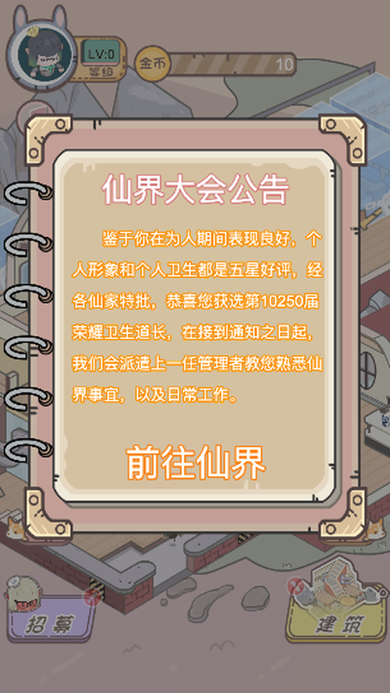
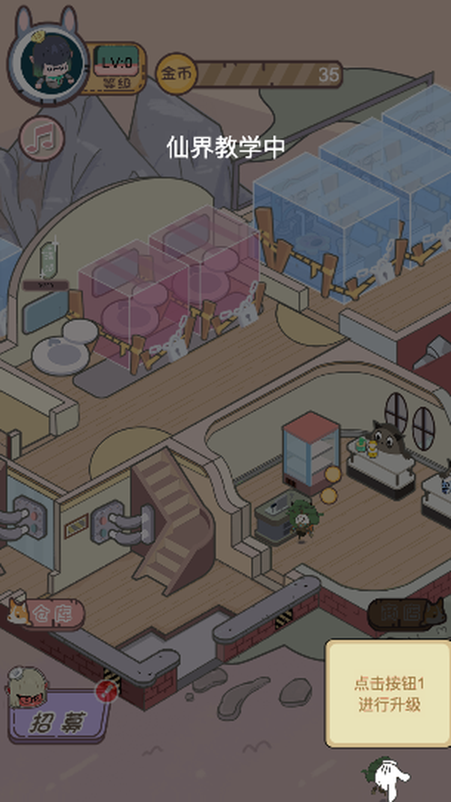
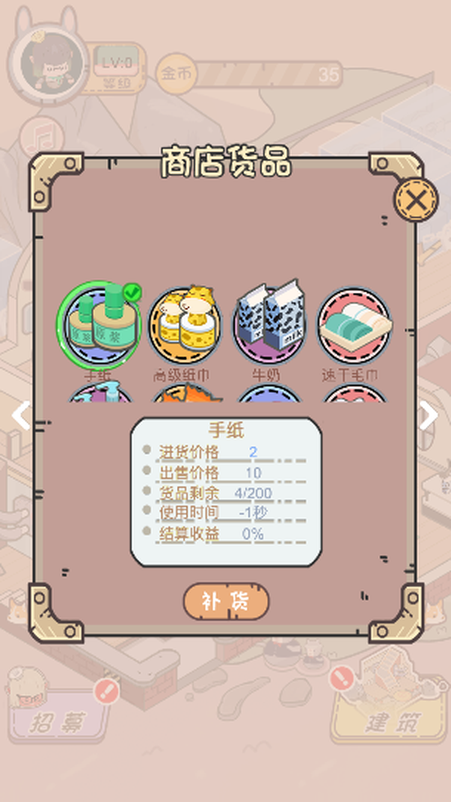
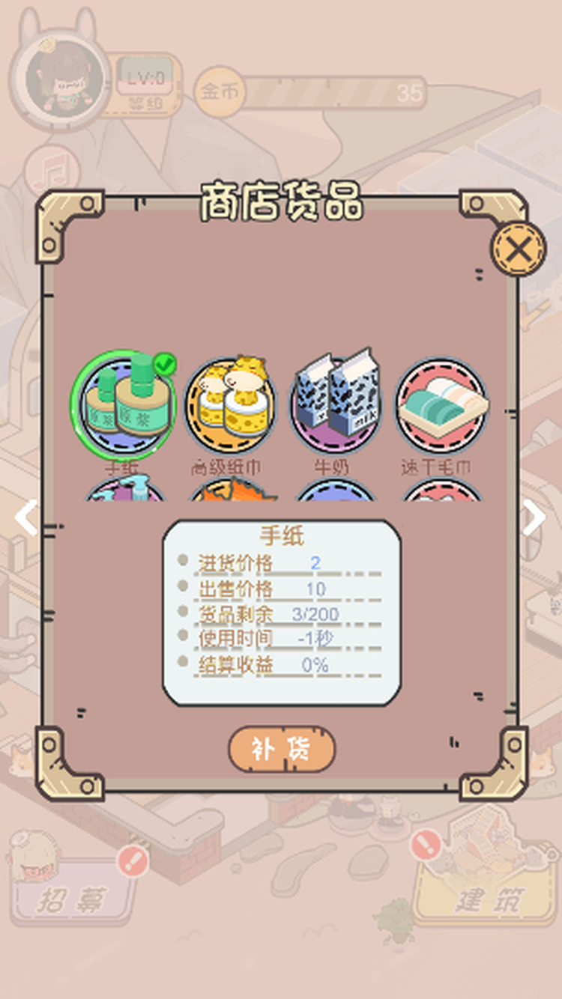

# 五星卫生院（Cocos Creator 3.8.8 版）

一款**纯离线**的竖屏放置经营类小游戏：你被仙界任命为「卫生道长」，接管一所破旧的卫生院，通过建设设施、补货商品、雇佣员工、打扫卫生，把它经营成五星卫生院。

> 本仓库包含同一游戏的两个引擎版本：`五星卫生院-2.4.12/`（Cocos Creator 2.4.12）与 `五星卫生院-3.8.8/`（Cocos Creator 3.8.8，本目录）。
> **从游戏设计、UI 图产出、代码实现到自动化测试，全部由 WorkBuddy 独立完成**；所使用的大模型为 **HY3 免费版**；**游戏研发耗时 6 小时**。

## 运行截图（竖屏，仅游戏预览区）

| 仙界大会公告（开场） | 新手引导（仙界教学） | 主场景经营 |
|---|---|---|
|  |  |  |

| 商店补货 | 仓库道具 |
|---|---|
|  |  |

## 玩法详情

### 核心循环
1. **顾客上门**：顾客自动进入已开放的房间（洗手池/卫生间/病房等）使用设施，按秒产出金币，同时累积「脏污度」。
2. **打扫维护**：脏污度满后设施停用，需使用仓库道具（抹布/刷子/马桶塞/高效去污器等）或雇佣清洁员工自动打扫。
3. **升级扩建**：消耗金币升级 12 个房间（每房间 3 级），提升产出与容量；等级提升解锁新房间（玄关→商店→仓库→污水→洗手池→卫生间×3）。
4. **补货售卖**：商店 13 种商品（手纸/高级纸巾/清洁剂等）需手动补货（支持长按连买），顾客消费商品带来额外金币与结算分成。
5. **招募员工**：8 名员工（小太白/小灵宝等，1~5 星）可招募，自动打扫/自动补货，降低操作压力；2 名特殊员工通过激励获得。
6. **外观收集**：34 种外观（入口/地面/楼梯/墙面等）按金币阈值解锁，改变场景视觉。

### 成长与通关
- **等级**：累计金币达到阈值自动升级（LV1→LV39，阈值 84 → 778,468 金币指数增长），升级解锁房间/道具/商品/员工。
- **通关**：全部 12 房间升至 3 级、10 种道具购齐、13 种商品购满、8 名员工全员招募、34 种外观全解锁、10 个房间全开放，即达成「五星卫生院」通关态。

### 新手引导（仙界教学）
32 步交互式引导：镂空高亮 + 手势指引 + 逐字文案，覆盖建设→升级→解锁→外观→营业→补货→打扫→仓库全流程；引导期间其余点击被屏蔽，防止误操作。

### 操作方式
- 点击底部四大入口：仓库 / 商店 / 招募 / 建筑。
- 点击设施上的升级按钮升级；点击脏污设施上的打扫按钮打扫。
- 商店内点击商品选中、长按补货按钮连续补货。
- 纯单机离线：**无任何网络请求、无广告、无登录、无内购**；存档保存在本地（localStorage / 原生本地存储）。

## 技术说明（3.8.8 版）
- TypeScript 严格模式（tsc 0 错误迁移自 2.4.12 版，96 个脚本、312 处 API 适配）。
- 屏幕适配：设计分辨率 750×1334，SHOW_ALL + Widget 四边对齐 + letterbox 纯色延伸带（ScreenEdgeFill），任意分辨率/密度无拉伸、无裁切、无黑边。
- 原生（Android）适配：竖屏 manifest；jsb 环境 DOM 特征探测；引导镂空在原生走 Graphics 遮罩（规避 shader 渲染异常）。
- 自动化测试：浏览器全遍历套件 + Android 模拟器 adb 全控件遍历/引导走完/monkey 压力/白屏像素检测，全部通过。

## 运行方式
1. 安装 Cocos Creator **3.8.8**。
2. 用 Creator 打开本目录（`五星卫生院-3.8.8/`）。
3. 点击编辑器「预览」即可在浏览器游玩（竖屏手机比例窗口体验最佳）。
4. 打包 Android：Build 面板选择 Android，或 CLI `--build "configPath=..."`（需 NDK r27b、JDK 21）。

## 声明
- 游戏设计 / UI 图产出 / 代码 / 测试：**WorkBuddy 独立完成**。
- 大模型：**HY3 免费版**。
- 研发耗时：**6 小时**。
- 纯离线单机，不含任何第三方 SDK、广告或网络服务。
